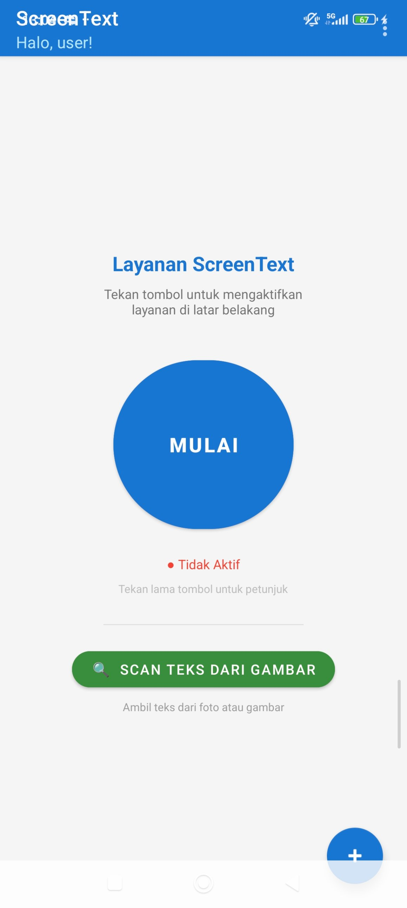
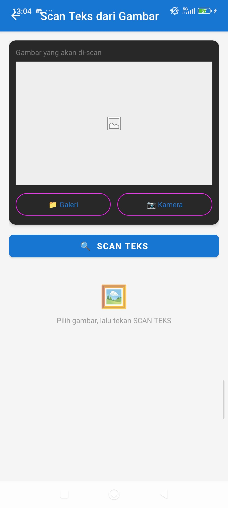
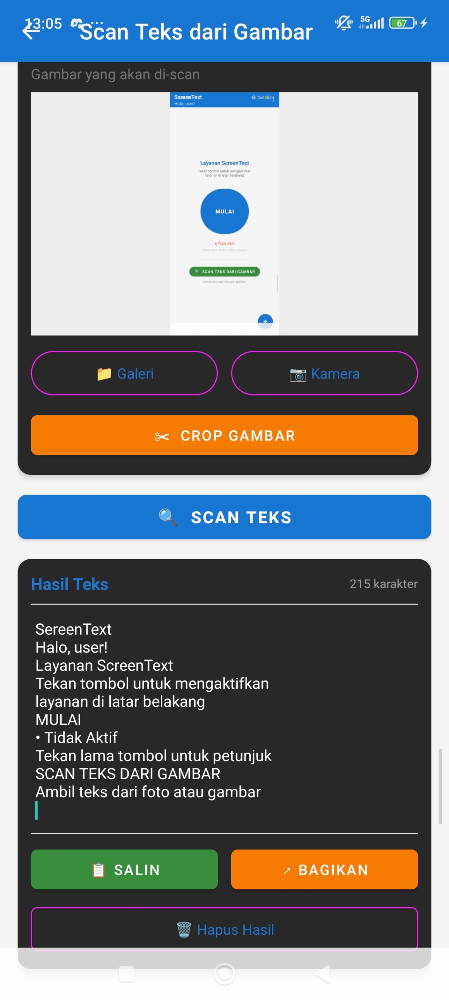

# ScreenTextApp — Tugas 2: Logika Interaktif & Navigasi

Aplikasi Android untuk **mengekstrak teks dari gambar (OCR)** dan **scan teks langsung dari layar** menggunakan layanan latar belakang dengan overlay melayang.

---

## 📱 Screenshot Aplikasi

| Home Screen | Scan Teks dari Gambar | Hasil OCR |
|:-----------:|:---------------------:|:---------:|
|  |  |  |

---

## ✨ Fitur Versi 3.0 (Terbaru)

### 1. 🔍 Scan Teks dari Gambar (ScanActivity)
Fitur utama untuk mengekstrak teks dari foto atau gambar.

**Cara pakai:**
1. Buka **Scan Teks dari Gambar** dari Home
2. Pilih sumber gambar: **Galeri** atau **Kamera**
3. *(Opsional)* Tekan **✂ Crop Gambar** untuk memilih area tertentu
4. Tekan **SCAN TEKS** — teks diekstrak secara otomatis
5. Hasil teks tampil di kartu bawah, bisa **Disalin** atau **Dibagikan**

> Izin akses foto akan diminta saat pertama kali membuka fitur ini.

---

### 2. ✂ Crop Gambar *(Baru di v3.0)*
Tombol **CROP GAMBAR** (oranye) muncul otomatis setelah gambar dipilih, memungkinkan pengguna memotong bagian gambar sebelum di-scan.

- Mendukung crop bebas (free-style) tanpa rasio tetap
- Menggunakan library **UCrop** dengan antarmuka yang ramah
- Toolbar berwarna biru senada dengan tema aplikasi
- Hasil crop langsung dipakai untuk proses OCR

---

### 3. 🎨 Perbaikan Tampilan Hasil Teks *(Fix di v3.0)*
Teks hasil OCR sebelumnya tidak terlihat karena warnanya sama dengan background kartu.

- **Sebelum:** Teks berwarna gelap pada latar gelap → tidak terbaca
- **Sesudah:** Teks berubah menjadi **putih (#FFFFFF)** sehingga terbaca jelas
- Karakter counter (`215 karakter`) ditampilkan di pojok kanan atas

---

### 4. 🛡 Layanan Latar Belakang — Floating Overlay *(Baru di v3.0)*
Layanan yang berjalan di background dan menampilkan tombol melayang di atas semua aplikasi untuk scan teks langsung dari layar tanpa perlu keluar aplikasi.

**Cara mengaktifkan:**
1. Di Home, tekan tombol **MULAI**
2. Jika belum ada izin overlay → dialog akan membuka **Pengaturan** secara otomatis
   - Aktifkan izin *"Tampil di atas aplikasi lain"* untuk ScreenTextApp
3. Kembali ke aplikasi, tekan **MULAI** lagi
4. Status berubah menjadi **● Aktif** (hijau) dan ikon scan melayang muncul di layar
5. Tekan **BERHENTI** untuk menghentikan layanan

**Cara menggunakan overlay:**
1. Buka aplikasi/konten apapun yang ingin di-scan teksnya
2. Ketuk **ikon melayang** (bisa digeser-geser posisinya)
3. Izinkan tangkap layar saat dialog sistem muncul
4. Layar crop muncul — **seret** untuk memilih area teks
5. Tekan **Scan Teks Area Ini**
6. Hasil OCR muncul sebagai **popup** di bagian bawah layar
7. Pilih **Salin**, **Bagikan**, atau **Tutup**

---

## 🏗 Arsitektur & Teknologi

| Komponen | Teknologi |
|----------|-----------|
| Bahasa | Kotlin |
| OCR Engine | Google ML Kit Text Recognition (offline) |
| Crop Gambar | UCrop 2.2.9 |
| Image Loading | Coil 2.7.0 |
| Screen Capture | MediaProjection API |
| Floating View | WindowManager `TYPE_APPLICATION_OVERLAY` |
| Background Service | Foreground Service + NotificationChannel |
| UI | ViewBinding + Material Design 3 |

---

## 📂 Struktur File Utama

```
app/src/main/
├── java/com/example/screentextapp/
│   ├── LoginActivity.kt          # Halaman login
│   ├── HomeActivity.kt           # Home + tombol MULAI overlay
│   ├── ProfilActivity.kt         # Profil pengguna
│   ├── ScanActivity.kt           # Scan teks dari gambar + crop
│   ├── FloatingOverlayService.kt # Foreground service overlay
│   ├── CapturePermissionActivity.kt # Minta izin MediaProjection
│   ├── CropSelectionActivity.kt  # Pilih area crop dari screenshot
│   ├── CropView.kt               # Custom view rubber-band selection
│   └── FloatingResultHolder.kt   # Singleton transfer hasil OCR
└── res/
    ├── layout/
    │   ├── activity_scan.xml
    │   ├── activity_crop_selection.xml
    │   ├── layout_floating_button.xml
    │   └── layout_floating_result.xml
    └── values/themes.xml
```

---

## 🔐 Izin yang Dibutuhkan

| Izin | Kegunaan |
|------|----------|
| `CAMERA` | Ambil foto langsung dari kamera |
| `READ_MEDIA_IMAGES` | Akses galeri foto (Android 13+) |
| `READ_EXTERNAL_STORAGE` | Akses galeri foto (Android ≤12) |
| `FOREGROUND_SERVICE` | Jalankan layanan latar belakang |
| `FOREGROUND_SERVICE_MEDIA_PROJECTION` | Tangkap layar (Android 14+) |
| `SYSTEM_ALERT_WINDOW` | Tampilkan tombol melayang di atas aplikasi lain |

---

## 🚀 Cara Build & Install

1. Clone/buka project di **Android Studio**
2. Pastikan koneksi internet aktif (untuk download dependency pertama kali)
3. Build → Run ke device fisik

> ⚠️ Fitur **Layanan Latar Belakang** (screen capture + overlay) **tidak berfungsi di emulator** — harus ditest di device fisik.

---

## 📝 Changelog

### v3.0.0
- ✅ Tambah fitur **Crop Gambar** (UCrop) di ScanActivity
- ✅ Fix **warna teks hasil** OCR menjadi putih agar terbaca
- ✅ Implementasi **FloatingOverlayService** (foreground service)
- ✅ Tambah **CapturePermissionActivity** untuk izin MediaProjection
- ✅ Tambah **CropSelectionActivity** untuk seleksi area dari screenshot
- ✅ Tambah **CropView** (custom rubber-band selection view)
- ✅ Tombol MULAI di HomeActivity terhubung ke overlay service

### v2.0.0
- ✅ Tambah fitur Scan Teks dari Gambar (ML Kit OCR offline)
- ✅ Integrasi Coil untuk image loading
- ✅ Tombol Salin & Bagikan hasil teks

### v1.0.0
- ✅ Login, Home, Profil Activity
- ✅ Navigasi antar halaman dengan Intent
- ✅ Menu toolbar & FAB

---

## 👨‍💻 Info

- **Package:** `com.example.screentextapp`
- **Min SDK:** 24 (Android 7.0)
- **Target SDK:** 35 (Android 15)
- **Kotlin JVM:** 17
